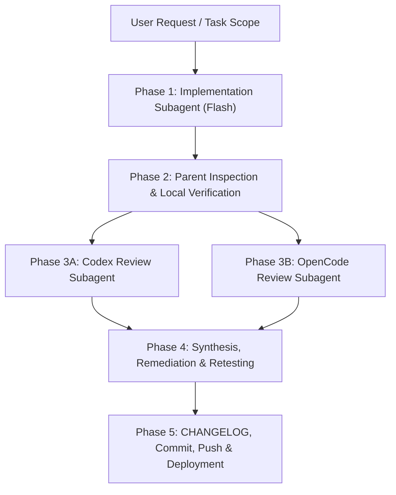

# Dual-Code-Review Development Workflow Specification

Use this workflow for all feature developments, bug fixes, UI/UX enhancements, and refactoring tasks. It guarantees code quality, security, and stability through multi-agent collaboration and dual independent code reviews.

---

## Workflow Architecture

---

## 5-Phase Execution Protocol

### Phase 1: Implementation Subagent (Flash Model)
1. **Delegation**:
   - Invoke an implementation subagent via `invoke_subagent`:
     - `TypeName`: `"self"`
     - `Model`: `"flash"`
     - `Role`: `"Feature Developer"`
     - `Prompt`: Provide clear requirements, files to modify, design tokens, and constraints.
2. **Responsibilities**:
   - Implement the requested code changes.
   - Ensure responsive design, accessibility (WCAG), and clean code.
   - Report back summary of modified files and verification results.

---

### Phase 2: Parent Inspection & Local Verification
1. **Inspection**:
   - Inspect the git diff using `git diff --stat` and `git diff`.
   - Ensure compliance with global security rules (NEVER hardcode API keys or secrets).
   - Verify design token alignment, typography scale, and responsive behavior.
2. **Local Test & Build**:
   - Run unit tests: `npm test` (or project test runner).
   - Run typecheck and production build: `npm run build`.
   - Confirm all tests pass and zero TypeScript errors exist.

---

### Phase 3: Dual Independent Code Reviews

Dispatch two specialized reviewer subagents in parallel or sequentially:

#### Subagent 3A: Codex Code Reviewer
- **Target**: Run OpenAI Codex CLI non-interactively on uncommitted changes.
- **Invocation**:
  - `TypeName`: `"self"`
  - `Model`: `"inherit"`
  - `Role`: `"Codex Code Reviewer"`
  - `Prompt`: Execute `codex review --uncommitted` with custom prompt targeting correctness, edge cases, UX, performance, and security. Parse and return structured findings categorized by severity (P1 Critical, P2 Warning, P3 Suggestion).

#### Subagent 3B: OpenCode Code Reviewer
- **Target**: Run OpenCode CLI non-interactively to inspect working tree diff.
- **Invocation**:
  - `TypeName`: `"self"`
  - `Model`: `"inherit"`
  - `Role`: `"OpenCode Code Reviewer"`
  - `Prompt`: Execute `opencode run "Review the current uncommitted git diff for code quality, edge cases, CSS/RWD issues, and potential regressions. Provide concise, actionable feedback with priority levels (P1/P2/P3)."` and return structured findings.

---

### Phase 4: Review Synthesis, Remediation & Verification
1. **Consolidation**:
   - Parent agent reviews findings from both Codex and OpenCode.
   - Discard false positives; highlight valid P1/P2 issues and high-value P3 improvements.
2. **Remediation**:
   - Fix all valid issues identified by the reviewers.
3. **Re-Verification**:
   - Re-run `npm test` and `npm run build` to ensure 100% test pass rate and clean build.

---

### Phase 5: CHANGELOG, Commit, Push & Deployment
1. **Mandatory CHANGELOG Update**:
   - Update `CHANGELOG.md` (or project changelog) with the release version, date, and detailed bullet points of all additions, improvements, and fixes.
2. **Security & Cleanliness Audit**:
   - Ensure zero secrets or sensitive keys are staged.
   - Clean up any temporary artifacts or scratch files.
3. **Commit & Push**:
   - Commit with Conventional Commits format (e.g., `feat(concierge): add floating concierge receptionist widget`).
   - Push to remote: `git push origin main`.
4. **Deployment Verification**:
   - Verify Cloudflare Pages / Workers or hosting CI build status.
   - Confirm production rollout.
